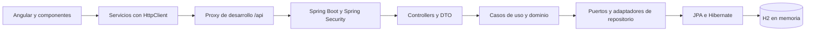

# Documentación del Entregable 3 de BOHEME

Programación Avanzada · Universidad del Quindío · Revisión documental del 15 de noviembre de 2026.

Esta entrega conecta el frontend Angular con el backend Spring Boot existente. El documento explica el recorrido de los datos y las decisiones del código. Se revisaron ambos proyectos sin modificar su comportamiento. Las verificaciones de código, las ejecuciones actuales y las evidencias anteriores se distinguen en la sección 16. El recorrido interactivo completo y la revisión móvil siguen pendientes; no se asigna una nota.

## Convenciones para consultar las fuentes

Las rutas `src/app/...` pertenecen a **boheme-frontend**. Para evitar repetir una ruta larga, las referencias Java utilizan estos prefijos, todos dentro de **ecommerce-PA**:

| Prefijo | Ruta completa relativa a la raíz del backend |
| --- | --- |
| `J/` | `src/main/java/com/uniquindio/ecommerce/` |
| `T/` | `src/test/java/com/uniquindio/ecommerce/` |
| `REST/` | `src/main/java/com/uniquindio/ecommerce/infrastructure/rest/` |
| `UC/` | `src/main/java/com/uniquindio/ecommerce/application/usecase/` |
| `DTO/` | `src/main/java/com/uniquindio/ecommerce/application/dto/` |
| `SEC/` | `src/main/java/com/uniquindio/ecommerce/infrastructure/security/` |
| `JPA/` | `src/main/java/com/uniquindio/ecommerce/infrastructure/persistence/jpa/` |

Los antecedentes de estilo y alcance son `../ecommerce-PA/INFORME_COMPLETO_ENTREGABLE_2.md`, su README y los documentos de persistencia, seguridad y flujo de compra de `docs/`. Las afirmaciones históricas sobre una entrega anterior no describen necesariamente el estado de esta entrega.

## 1. Introducción

BOHEME es un marketplace de prendas de vestir de diseñadores, talleres y marcas independientes. Busca que un creador publique sus prendas con tallas e inventario y que un comprador pueda encontrarlas, guardarlas y convertir su selección en un pedido. El nicho es la ropa de autor; no se trata de un catálogo genérico de productos.

La Entrega 2 desarrolló el backend: modelo de dominio, casos de uso, API REST, validaciones, JWT, autorización, persistencia JPA/H2 y pruebas. La Entrega 3 incorpora Angular y Bootstrap, con pantallas, formularios reactivos, servicios HTTP, navegación por sesión y rol, bolsa, pedidos, notificaciones y favoritos como funcionalidad propia. El frontend consume la API real; no contiene una lista fija de prendas que sustituya al servidor.

La confirmación crea un pedido `PENDIENTE`; no procesa pagos. Las tarjetas y el detalle indican que no hay fotografía disponible: no hay carga de imágenes implementada.

## 2. Arquitectura general



Un clic en Angular desencadena una llamada a un servicio. Este prepara una petición HTTP; Spring Security valida el token cuando corresponde y el controller recibe los DTO. Los casos de uso coordinan las reglas y el acceso a repositorios. Los adaptadores JPA traducen entre dominio y filas. La respuesta vuelve como JSON y Angular actualiza su estado para mostrarla.

El proxy es parte del servidor de desarrollo de Angular, no una capa del backend. El interceptor actúa antes de enviar solicitudes y al recibir errores. Frontend y backend están en carpetas hermanas independientes: `boheme-frontend` y `ecommerce-PA`. Cada proyecto tiene sus propias dependencias, configuración, comandos y repositorio Git. Separarlos permite construir cada parte por su cuenta y conservar un contrato HTTP explícito; también exige iniciar ambos procesos y mantener ese contrato consistente.

## 3. Tecnologías utilizadas

| Tecnología declarada | Función en BOHEME |
| --- | --- |
| Angular 20.3 y Router | Componentes standalone, rutas, inyección y navegación |
| TypeScript 5.9 | Interfaces para describir datos y detectar incompatibilidades durante compilación |
| HttpClient y RxJS 7.8 | Peticiones, manejo de respuestas, debounce y cancelación de consultas anteriores |
| Signals y `computed` | Estado reactivo de sesión, catálogo, carga, avisos y totales |
| Formularios reactivos | Controles y validaciones de login, registro, publicación, cantidades y stock |
| Bootstrap 5.3 | Cuadrícula, tarjetas, formularios, navbar y utilidades adaptables |
| Java 21 y Spring Boot 4.1.1 | API y composición de seguridad, validación y persistencia |
| Spring Security y Nimbus JWT | Verificación de Bearer firmado con HS256, roles e identidad |
| JPA, Spring Data y Hibernate | Entidades relacionales, consultas, transacciones y bloqueos |
| H2 | Base local en memoria para demostración y pruebas |
| Vitest, jsdom y Angular TestBed | Pruebas de servicios, sesión, interceptor, guards y consultas |
| JUnit, Mockito y herramientas de Spring | Pruebas de dominio, controladores, persistencia, seguridad e integración |
| Gradle Wrapper y Angular CLI | Construcción y ejecución reproducible de cada proyecto |

Las versiones anteriores son las declaradas en `package.json` y `build.gradle`, no recomendaciones de actualización. La ejecución de Vitest resolvió 3.2.7 desde el lockfile. El driver MariaDB existe en Gradle, pero la conexión operativa revisada es H2; no se documenta una migración a MariaDB.

## 4. Organización del frontend

`src/app/core/` concentra los elementos compartidos de aplicación. No existen subcarpetas separadas llamadas `services`, `models`, `guards` e `interceptors`: esos archivos conviven en `core`.

| Ubicación real | Responsabilidad |
| --- | --- |
| `src/app/core/models.ts` | `Prenda`, `Variante`, `PaginaPrendas`, `Sesion`, `Bolsa`, `Pedido` y otros contratos |
| `src/app/core/catalog.service.ts` | Buscar, consultar, publicar y mantener prendas |
| `src/app/core/auth.service.ts` | Login, registro, persistencia y estado de sesión |
| `src/app/core/bag.service.ts` | Bolsa activa, creación, artículos, vaciado y confirmación |
| `src/app/core/orders.service.ts` | Consulta de pedidos propios |
| `src/app/core/favorites.service.ts` | Lista, alta y eliminación de favoritos |
| `src/app/core/notifications.service.ts` | Avisos y traducción de errores HTTP |
| `src/app/core/guards.ts` | Funciones `authGuard`, `guestGuard`, `roleGuard` |
| `src/app/core/auth.interceptor.ts` | Bearer y finalización de sesión rechazada |
| `src/app/pages/home.component.ts` | Inicio |
| `src/app/pages/auth.component.ts` | Login y registro con modo determinado por la ruta |
| `src/app/pages/catalog.component.ts` | Búsqueda, páginas y favoritos en tarjetas |
| `src/app/pages/detail.component.ts` | Detalle, variante, cantidad, bolsa y favoritos |
| `src/app/pages/seller.component.ts` | `SellerComponent` y `PublishComponent` |
| `src/app/pages/compras.component.ts` | `BolsaComponent`, `PedidosComponent`, `FavoritosComponent` |
| `src/app/shared/product-card.component.ts` | Tarjeta reutilizable |
| `src/app/shared/status.component.ts` | Estados de carga, error y vacío |
| `src/app/shared/money.pipe.ts` | Presentación de dinero |
| `src/app/app.component.ts` | Navbar, menú, sesión, avisos, salida y pie |
| `src/app/app.routes.ts` | Rutas, títulos, roles, 404 y acceso denegado |
| `src/main.ts` | Arranque, proveedores HTTP, interceptor y Router |

Las plantillas están incluidas en los archivos TypeScript mediante `template`; no deben buscarse archivos HTML de cada pantalla. Las dos rutas del vendedor cargan componentes mediante `loadComponent`. Se usa `provideZonelessChangeDetection()`; la actualización de los estados se apoya en Signals.

## 5. Comunicación con el backend

`provideHttpClient(withInterceptors([authInterceptor]))` registra el cliente y el interceptor en `src/main.ts`. Los servicios inyectan `HttpClient`, seleccionan método/ruta y describen el tipo esperado. El componente se ocupa de acciones de pantalla, carga y resultados. Así, `CatalogComponent` no repite direcciones de API ni construye HTTP directamente.

`CatalogService.search(q, page, size)` envía `GET /api/prendas` con `HttpParams`; recorta el texto y utiliza páginas desde cero. `proxy.conf.json` reenvía `/api` a `http://localhost:8080` con `changeOrigin: true` y `secure: false`. Esto último no habilita HTTPS: el destino local es HTTP. No se encontraron archivos environment ni `fileReplacements` para una URL de API.

En `SEC/SecurityConfig.java`, CORS admite los métodos GET, POST, PATCH, DELETE y OPTIONS, y los encabezados Authorization, Content-Type y Accept. Expone Location y WWW-Authenticate. El origen predeterminado es `http://localhost:4200`; `application-dev.properties` permite además `http://127.0.0.1:4200`. No se usa `allowCredentials` ni origen comodín. El proxy evita el cruce de origen desde el navegador durante el desarrollo habitual; CORS sigue siendo necesario para accesos directos permitidos a la API y está cubierto por pruebas.

### Un contrato real entre TypeScript y Java

En `src/app/core/models.ts`:

```typescript
export interface Prenda {
  prendaId: string; creadorId: string; nombre: string; descripcion: string;
  precioBase: Dinero; variantes: Variante[]; stockTotal: number;
  disponibleParaLaVenta: boolean;
}
```

En `DTO/response/PrendaResponse.java`:

```java
public record PrendaResponse(
    UUID prendaId, UUID creadorId, String nombre, String descripcion,
    DineroResponse precioBase, List<VariantePrendaResponse> variantes,
    int stockTotal, boolean disponibleParaLaVenta
) {}
```

Los UUID se serializan como cadenas; las listas como arreglos; `DineroResponse` corresponde a `Dinero`, con `monto` y `moneda`. No es obligatorio que los tipos de ambos lenguajes se llamen igual: sí deben coincidir los nombres y las formas de los campos JSON porque no existe aquí un mapper que renombre propiedades al recibirlas. Si Java cambiara `prendaId` por `id`, Angular no encontraría `p.prendaId`. La interfaz ayuda al compilar, pero desaparece en ejecución y no valida por sí sola un JSON recibido.

### Operaciones usadas por Angular

| Método y ruta | Servicio Angular | Resultado principal y acceso |
| --- | --- | --- |
| POST `/api/auth/login` | AuthService.login | 200, `LoginResponse`; público |
| POST `/api/auth/register` | AuthService.register | 201, `UsuarioResponse`; público |
| GET `/api/prendas?q=&page=0&size=12` | CatalogService.search | 200, `PaginaPrendasResponse`; público |
| GET `/api/prendas/{prendaId}` | CatalogService.detail | 200, `PrendaResponse`; público |
| GET `/api/prendas/creador/{creadorId}` | CatalogService.own | 200, arreglo de prendas; público en backend |
| POST `/api/prendas` | CatalogService.publish | 201; VENDEDOR y creador propio |
| PATCH `/api/prendas/{prendaId}/variantes/{varianteId}/stock` | CatalogService.stock | 204; vendedor propietario |
| PATCH `/api/prendas/{prendaId}/suspender` | CatalogService.suspend | 204; vendedor propietario |
| GET `/api/bolsas/activas/{clienteId}` | BagService.active | 200 o 404; comprador propio |
| POST `/api/bolsas` | BagService.create | 201; comprador propio |
| POST `/api/bolsas/{bolsaId}/items` | BagService.add | 200; comprador propietario |
| DELETE `/api/bolsas/{bolsaId}/items` | BagService.clear | 204; comprador propietario |
| POST `/api/bolsas/{bolsaId}/confirmar-pedido` | BagService.confirm | 201, pedido; comprador propietario |
| GET `/api/pedidos` y `/api/pedidos/{pedidoId}` | OrdersService.list/detail | 200; pedidos propios |
| GET `/api/favoritos` | FavoritesService.list | 200, prendas propias; COMPRADOR |
| POST `/api/favoritos/{prendaId}` | FavoritesService.add | 201; 409 duplicado; COMPRADOR |
| DELETE `/api/favoritos/{prendaId}` | FavoritesService.remove | 204; 404 si no es propio; COMPRADOR |

Controllers: `REST/controller/AuthController.java`, `PrendaController.java`, `BolsaDeEstiloController.java`, `CompraController.java` y `FavoritoController.java`. El backend también ofrece cierre manual de bolsa y reporte de creadores; no son pantallas adicionales implementadas en Angular.

## 6. Login y autenticación JWT

1. El usuario escribe correo y contraseña en `/login`, representado por `AuthComponent`.
2. El formulario reactivo comprueba correo válido, obligatoriedad y límites; no envía si es inválido o ya hay una solicitud pendiente.
3. `AuthService.login` realiza POST `/api/auth/login` con `{ correo, password }`.
4. La ruta está permitida en Spring Security; `AuthController` valida el DTO y delega en `IniciarSesionUseCase`. Este busca al usuario, comprueba BCrypt y cuenta activa. La contraseña no se compara en Angular.
5. `NimbusEmisorTokens.emitir` genera un JWT HS256 con el secreto configurado por el backend.
6. Angular recibe `token`, `tokenType`, `expiresIn`, `expiresAt`, `rol` y `usuario`. Guarda la sesión JSON en la clave **`boheme.session`** de localStorage.
7. `session.set(s)` actualiza la Signal; `user` y `authenticated` son valores derivados con `computed`. El menú cambia según usuario y rol.
8. El Router envía a un `returnUrl` local validado o a `/catalogo`; los guards habilitan las rutas correspondientes.
9. El logout borra la Signal y localStorage. `AppComponent.logout()` muestra «Has cerrado sesión.» y navega al inicio.

Si localStorage no está disponible, el login conserva la sesión en memoria. La restauración descarta JSON inválido, usuarios inactivos, roles inconsistentes o `expiresAt` vencido. Esto mejora la navegación, pero no valida la firma del token: esa comprobación pertenece al backend. No hay refresh token ni renovación automática implementada.

El JWT tiene **header.payload.firma**. El header declara `HS256` y tipo JWT. El payload contiene `iss` = `boheme`, `sub` = UUID de usuario, `iat`, `exp`, `jti`, `correo` y `rol`. La firma permite detectar alteraciones con el secreto del servidor. Header y payload se pueden decodificar; no están cifrados. No contienen contraseña ni hash, y no son un lugar para secretos. Leerlos o cambiar el rol en el texto no produce un token válido.

`JwtConfig` valida firma/algoritmo, emisor, tiempos y claims requeridos. `SecurityConfig` contrasta identidad, rol, correo y estado activo con el repositorio de usuarios. La duración predeterminada configurada es una hora. `expiresAt` del DTO coincide con la expiración emitida con precisión de segundos.

## 7. Interceptor HTTP

`src/app/core/auth.interceptor.ts` está registrado una vez en `main.ts`. Identifica rutas `/api` o que empiezan por `/api/`, excluye `/api/auth/` para el envío de credenciales y captura la sesión vigente. Cuando hay token utilizable, clona la solicitud inmutable:

```typescript
request.clone({ setHeaders: { Authorization: `Bearer ${token}` } })
```

Al recibir 401 de una API que no es auth, intenta expirar esa misma sesión mediante `auth.expire(captured.token)`. Si corresponde, borra la sesión, muestra **«Tu sesión terminó. Inicia sesión para continuar.»** y navega a `/login` con `returnUrl`. Después propaga el error para que el componente lo gestione. Por eso puede aparecer además el mensaje de error del componente. El diseño evita varios avisos de expiración por 401 simultáneos y evita borrar una sesión nueva cuando termina una solicitud vieja.

Si la fecha local ya venció, el interceptor finaliza la sesión antes de enviar el token. Un 403 no provoca logout. Un 401 de login se muestra en el formulario y no se interpreta como vencimiento de una sesión previa. Estas condiciones están cubiertas en `src/app/core/auth.interceptor.spec.ts`.

**Demostración real del 401:** iniciar como comprador con una sesión recién emitida; conservar `expiresAt`, usuario y rol; alterar únicamente el primer carácter de la tercera parte del token en la sesión de localStorage; recargar directamente `/favoritos`. La restauración y el guard aceptan la fecha vigente, pero la firma cambiada falla en Spring Security. Así se obtiene una respuesta 401 real a GET `/api/favoritos` y se observa el interceptor. No hace falta desactivar guards ni validaciones. Cambiar solo la fecha a una vencida demostraría el guard, pero podría no enviar esa petición. El Word incluye el procedimiento exacto; eliminar después la sesión alterada e iniciar otra vez.

## 8. Guards

Los tres son funciones `CanActivateFn` de `src/app/core/guards.ts`, aunque en la rúbrica se llamen AuthGuard, GuestGuard y RoleGuard.

| Guard | Qué comprueba | Rutas y ejemplo |
| --- | --- | --- |
| `authGuard` | `AuthService.valid()`: sesión existente y fecha futura | `/vendedor`, `/vendedor/publicar`, `/bolsa`, `/pedidos`, `/favoritos`. Sin sesión, `/bolsa` devuelve UrlTree a login con `returnUrl=/bolsa` |
| `guestGuard` | Que no exista una sesión local válida | `/login` y `/registro`; si ya hay sesión, envía a `/catalogo` |
| `roleGuard` | `user()?.rol === route.data['role']` | Las dos rutas del vendedor exigen VENDEDOR; bolsa, pedidos y favoritos COMPRADOR. Rol incorrecto envía a `/acceso-denegado` |

`app.routes.ts` coloca primero authGuard y luego roleGuard en las privadas. Devolver UrlTree permite que el Router gestione la redirección. Un guard controla la experiencia dentro de Angular; cualquiera puede llamar la API sin navegar por ella o manipular localStorage. Spring Security y los casos de uso siguen comprobando JWT, rol e identidad/propiedad en cada operación protegida. La pantalla de acceso denegado no es por sí misma una respuesta HTTP 403 de la API.

## 9. Catálogo de prendas

`CatalogComponent` llama a `CatalogService.search`, que consulta GET `/api/prendas`. `PrendaController.buscar` delega en `BuscarPrendasUseCase`; el adaptador `JpaPrendaDeAutorRepository` y `JPA/repository/PrendaJpaRepository.java` consultan los datos persistidos. Se buscan nombre o descripción sin distinguir mayúsculas y se ordena por nombre e ID. `%`, `_` y `!` se escapan para tratarlos literalmente. El backend también acepta filtros de creador y moneda, aunque la vista no ofrece esos controles.

El frontend empieza en `page=0`, `size=12` y ofrece 12, 24 o 48 elementos. El backend admite tamaños de 1 a 100 y tiene su propio valor predeterminado, 20, cuando el cliente no envía `size`. La respuesta contiene `content`, `totalElements`, `totalPages`, `page`, `size`. Los botones Anterior y Siguiente se muestran con varias páginas y se deshabilitan en los extremos. La interfaz muestra la página desde 1, mientras HTTP cuenta desde 0.

La búsqueda modifica query params de la URL después de `debounceTime(300)` y `distinctUntilChanged()`, reiniciando `page` a 0. Al cambiar esos parámetros, `switchMap` sustituye la petición anterior por la más reciente; evita que una respuesta vieja reemplace una búsqueda nueva. `takeUntilDestroyed` cancela suscripciones al destruir el componente. Las Signals `data`, `page`, `size`, `loading`, `error` y las de favoritos sostienen la vista; `set` y `update` informan a Angular de los cambios.

`StatusComponent` muestra carga, error con reintento y vacío: **«No hay prendas que coincidan»**. Una búsqueda sin resultados devuelve 200 con `content: []`, no 404. `PrendaJpaEntity` utiliza `@SoftDelete(columnName = "eliminado")`, de modo que las consultas ORM excluyen eliminadas. Suspender venta no elimina: las suspendidas pueden aparecer y se bloquea la compra. No hay botón ni endpoint REST para eliminar prendas en esta entrega; su exclusión está probada desde infraestructura. En el video se puede enseñar la prueba, sin fingir una eliminación desde la interfaz.

## 10. Formularios reactivos

Los componentes usan `ReactiveFormsModule`, `FormBuilder`, controles y `Validators`; sus valores no dependen de leer manualmente el DOM. Los mensajes aparecen al tocar controles o intentar enviar.

| Formulario y fuente | Validaciones y envío |
| --- | --- |
| Login, `auth.component.ts` | Correo requerido, formato y máximo 254; contraseña requerida y máximo 72 caracteres/bytes UTF-8; no exige mínimo 12 al autenticar una cuenta existente |
| Registro, mismo archivo | Nombre requerido, no solo espacios, máximo 100; correo; contraseña mínimo 12 y máximo 72 caracteres y 72 bytes UTF-8; rol; POST de registro y regreso al login, sin login automático |
| Publicación, `seller.component.ts` | Nombre/descripcion no vacíos; precio >=0,01 y hasta dos decimales; moneda de tres letras mayúsculas; FormArray con al menos una variante, SKU no vacío, talla y stock entero no negativo; impide SKU repetidos dentro del formulario y suma fuera del rango entero |
| Stock del taller, mismo archivo | Entero entre 0 y 2147483647 por variante |
| Selección de compra, `detail.component.ts` | Variante requerida; cantidad entera >=1; comprueba además cantidad frente a existencias consultadas |

En login se usa `busy` y `finalize`; publicación y compra tienen estados equivalentes para bloquear botones y solicitudes repetidas. La confirmación de bolsa es un botón de negocio, no un formulario de pago. No hay captura de tarjeta ni dirección de envío implementada. La validación del navegador ayuda al usuario; los DTO Java y el dominio vuelven a validar datos y reglas en el servidor.

## 11. Funcionalidades del vendedor

1. Iniciar con una cuenta VENDEDOR. El menú habilita «Mi taller» y las rutas están protegidas por sesión/rol.
2. Abrir `/vendedor/publicar`, representado por `PublishComponent` en `seller.component.ts`.
3. Escribir nombre, descripción, precio y moneda; completar SKU, talla y stock inicial. «Agregar variante» añade otro grupo al FormArray antes de enviar. No existe una operación separada de alta de variante después de publicar en esta pantalla.
4. El componente valida SKU distintos, calcula `stockTotal` inicial como suma de las variantes y toma `creadorId` del usuario de sesión.
5. `CatalogService.publish` envía POST `/api/prendas` con los campos de `Publicacion`. Precio y moneda viajan planos, según `RegistrarPrendaRequest`; el Response sí devuelve `precioBase` como objeto.
6. Spring Security exige VENDEDOR. `PrendaController.registrar` llama a `AutorizarRecursosUseCase.identidad(request.creadorId())`; el UUID recibido debe coincidir con el autenticado.
7. `RegistrarPrendaDeAutorUseCase`, mapper y repositorio guardan el agregado. `PrendaJpaEntity` y `VarianteJpaEntity` se almacenan en `prendas_autor` y `variantes_prenda`, con relación/cascada.
8. Con respuesta 201, Angular muestra **«Tu prenda se publicó correctamente.»**, el resultado y un enlace al detalle; restablece el formulario.

`SellerComponent` consulta las prendas del creador, permite PATCH de stock con `{ nuevoStock }` y suspensión de venta. Antes de cada modificación, el controller ejecuta `autorizar.prenda(prendaId)`. Cambiar el UUID en el cliente no permite modificar prendas ajenas: el servidor compara al propietario persistido con `UsuarioActual.id()`.

## 12. Funcionalidades del comprador

El catálogo y el detalle son públicos. Para comprar se necesita COMPRADOR. En `DetailComponent` se elige variante y cantidad; `BagService.addForUser` consulta la bolsa activa y, si recibe 404, crea una mediante POST `/api/bolsas`. Luego envía únicamente `{ varianteId, cantidad }` a POST `/api/bolsas/{bolsaId}/items`. El backend obtiene precio y moneda del catálogo; no acepta un total inventado por Angular. Agregar acumula cantidades, pero no reserva stock.

En `/bolsa`, `BolsaComponent` muestra líneas, precios, subtotales y total derivado. Se puede vaciar o confirmar. `ConfirmarPedidoUseCase` comprueba propietario y bolsa activa/no vacía, carga recursos con bloqueo, valida venta y stock, descuenta variantes, guarda el pedido y cierra la bolsa dentro de una transacción. Ordena los bloqueos de prendas para reducir conflictos. Si falla una regla, se revierte la operación; no debe quedar una compra parcial.

POST de confirmación responde **201**, `PedidoResponse` y Location. Angular muestra **«Pedido confirmado. Puedes consultar sus artículos.»**. `/pedidos` usa GET `/api/pedidos` y lista únicamente los del comprador autenticado, con valores históricos aunque cambie el catálogo. `OrdersService.detail` existe, pero no hay ruta/pantalla separada de detalle de pedido.

**Caso de demostración, no estado permanente:** publicar una prenda nueva, precio 19,95 COP, una variante M de stock 3. Entrar como comprador con bolsa vacía y agregar 2 unidades. Confirmar: total 39,90 COP y `stockDisponible` pasa de 3 a 1. Volver a cargar el detalle o consultar su GET para ver el dato del servidor. H2 puede tener otro estado según compras previas; usar una prenda y SKU nuevos para repetir el caso. El `stockTotal` inicial puede seguir en 3 porque se administra de forma independiente: no presentarlo como suma actualizada automáticamente. No hay pago real.

## 13. Funcionalidad propia de favoritos

Elegimos favoritos porque un comprador puede interesarse por una prenda sin decidir todavía talla o compra. Guardarla le evita repetir una búsqueda y permite volver a su selección. No modifica inventario, bolsa ni pedidos. Esta función corresponde al criterio propio de 10 puntos, sin anticipar la nota docente.

Angular usa `FavoritesService`: GET `/api/favoritos` lista, POST `/api/favoritos/{prendaId}` agrega sin cuerpo y DELETE de la misma ruta quita. `CatalogComponent` carga IDs de favoritos y permite alternar guardar/quitar; bloquea cada botón mientras está pendiente. `DetailComponent.favorite()` permite guardar y convierte el 409 en el aviso **«Esta prenda ya está en tus favoritos.»**. `FavoritosComponent` en `compras.component.ts` consulta y elimina, con carga, reintento y estado vacío.

El recorrido backend es `FavoritoController` → `FavoritosUseCase` → puerto `J/domain/repository/FavoritoRepository.java` → `JpaFavoritoRepository` → `FavoritoJpaRepository` → tabla **`favoritos`**. `FavoritoJpaEntity` contiene UUID propio, `comprador_id` y `prenda_id`. La restricción única `uk_favorito_comprador_prenda` impide dos filas para la misma combinación; el adaptador transforma ese conflicto en regla de dominio y HTTP 409. Dos compradores sí pueden guardar la misma prenda.

No se recibe un compradorId en el endpoint ni en el cuerpo: `FavoritosUseCase` obtiene `actual.id()` desde el contexto autenticado. Las consultas filtran por ese comprador y la eliminación usa la pareja comprador/prenda. Spring Security exige COMPRADOR. Así, conocer el UUID de una prenda no permite leer o borrar la lista de otra cuenta.

Para agregar, primero se busca la prenda mediante el repositorio que excluye soft delete: inexistente/eliminada responde 404. Al listar, las referencias se resuelven nuevamente; las eliminadas se omiten. Las suspendidas sí se conservan. Como la referencia de prenda es un UUID escalar, es posible quitar un favorito propio aunque la prenda haya sido eliminada. La persistencia es real en H2 durante la ejecución; no es solo un arreglo Angular ni almacenamiento permanente tras reiniciar Spring.

La prueba `T/infrastructure/rest/controller/Entrega3HttpIntegrationTest.java` cubre filas consultadas con JdbcTemplate, duplicados, aislamiento, roles, inexistentes/eliminadas/suspendidas y posibilidad de volver a agregar después de quitar. `commerce.spec.ts` comprueba el contrato HTTP del frontend, incluyendo que no se envía identidad de comprador.

## 14. Notificaciones y manejo de errores

`NotificationsService` conserva una Signal de mensajes con ID, texto y clase success/danger/info; los retira a los seis segundos y permite cierre manual. Conserva hasta los últimos cuatro. `AppComponent` los muestra con alertas Bootstrap y atributos accesibles. El servicio utiliza `error.message` del backend cuando existe; si no, usa un mensaje propio. Login maneja sus errores dentro del formulario; catálogo y detalle tienen también estados de error en la página.

| HTTP | Significado y ejemplo real | Mensaje o tratamiento |
| --- | --- | --- |
| 400 | DTO, UUID o parámetros inválidos | «La solicitud contiene datos inválidos.» y `details`; para JSON/parámetros inválidos hay mensaje específico del handler |
| 401 | Credenciales o token inválidos | Backend: «Credenciales o token inválidos.»; interceptor en API protegida: «Tu sesión terminó. Inicia sesión para continuar.» |
| 403 | Rol o propiedad insuficiente | Backend: «No tienes permiso para acceder a este recurso.»; fallback Angular: «Tu cuenta no tiene permiso para realizar esta acción.» |
| 404 | Prenda inexistente, favorito no propio o bolsa no existente | Detalle: «Esta prenda no existe o ya no está en la colección.»; bolsa activa sin datos se interpreta como estado vacío |
| 409 | Favorito repetido, stock insuficiente, bolsa cerrada o conflicto | Detalle de favorito: «Esta prenda ya está en tus favoritos.»; otras operaciones muestran el mensaje del backend |
| 500 | Error inesperado del servidor | «Ocurrió un error interno. Intenta nuevamente.»; backend registra la excepción sin enviarla al usuario |
| 0, estado del cliente | No se obtuvo respuesta HTTP | «No pudimos conectar con el servidor. Comprueba tu conexión e inténtalo de nuevo.» |

`REST/exception/ApiExceptionHandler.java` unifica timestamp, status, code, message, path y details. Para el video, repetir «Guardar en favoritos» desde detalle ofrece un 409 auténtico y aviso reproducible. Exceder la cantidad de stock desde el detalle puede mostrar **«La cantidad supera las existencias de esta variante.»** antes de HTTP; no debe presentarse como respuesta 409 del backend. No se provoca un 500 deliberadamente alterando código.

## 15. Bootstrap y diseño adaptable

Bootstrap está instalado por npm en `package.json`, y su CSS se carga en `angular.json` antes de `src/styles.css`. No hay importación de JavaScript Bootstrap: la hamburguesa se controla con la Signal `menu` en `AppComponent`, que cambia la clase `show` del collapse y sus atributos.

La navbar usa clases de expansión y enlaces por rol. El catálogo emplea `row`, `g-4`, `col-12 col-sm-6 col-lg-4`: una, dos o tres columnas según el ancho. Las tarjetas comparten `ProductCardComponent`. Login y publicación usan `form-control`, `form-select`, botones y alertas. Bolsa/pedidos usan `table-responsive` y flex con wrap.

`styles.css` agrega identidad visual, reglas de foco, tamaños fluidos y media queries para 991 y 575 px. En móvil el login pasa a una columna y la barra de búsqueda se apila. Esto está implementado y compila, pero la revisión documental no equivale a validar visualmente todos los dispositivos. Debe probarse en F12 a 390 px y con teclado, revisando hamburguesa, campos, avisos y ausencia de desplazamiento horizontal.

## 16. Pruebas realizadas

### Verificación de esta revisión

| Comprobación del 15 de noviembre de 2026 | Resultado y alcance |
| --- | --- |
| `npm test` en frontend | **43 pruebas correctas, 5 archivos**, Vitest 3.2.7; ejecución actual, duración reportada 9,41 s |
| `npm run build` en frontend | Correcta; bundle inicial 582,01 kB; salida `dist/boheme` |
| `gradlew.bat test` con JDK 21 | BUILD SUCCESSFUL; la tarea `test` aparece **UP-TO-DATE**. No se reejecutaron los casos |
| XML disponibles de Gradle | **237 pruebas en 26 clases**, 0 fallos, 0 errores y 0 omitidas; timestamps del 13 de noviembre 00:20 UTC, es decir 12 de noviembre 19:20 en Colombia. Evidencia de una ejecución anterior |
| Revisión de contratos y rutas | Inspección estática de servicios, DTO, controllers, seguridad y entidades; no una nueva prueba HTTP completa |

La diferencia con el antecedente de **231/25** se explica por el conjunto de reportes disponible: incluye `CorsDevIntegrationTest` con seis casos. No se reemplaza la historia ni se afirma una ejecución actual de 237 casos. `docs/entrega3-resultado-final.md` sigue siendo una evidencia de su propia fecha y alcance.

### Qué prueban los archivos del frontend

| Archivo | Casos actuales | Comportamiento comprobado |
| --- | --- | --- |
| `src/app/core/auth.service.spec.ts` | 13 | Contrato de login, guardado/restauración, datos inválidos, vencimiento y almacenamiento no disponible |
| `src/app/core/auth.interceptor.spec.ts` | 10 | Bearer, exclusiones, 401 concurrentes, sesión nueva frente a respuesta vieja, 403 y expiración local |
| `src/app/core/guards.spec.ts` | 6 | Anónimo, sesión válida/vencida, invitados y roles |
| `src/app/core/commerce.spec.ts` | 10 | Parámetros de catálogo, publicación, bolsa, confirmación, favoritos y pedidos |
| `src/app/pages/catalog.component.spec.ts` | 4 | Debounce, cancelación de petición vieja, normalización de parámetros y recuperación después de error |

Son pruebas con TestBed y HttpTestingController en jsdom. Comprueban lógica/contratos con respuestas controladas; no son pruebas end-to-end en un navegador con Spring real. Las pruebas backend incluyen `Entrega3HttpIntegrationTest`, `SeedDevEntrega3IntegrationTest`, `CorsDevIntegrationTest`, `SeguridadJwtIntegrationTest`, `CompraHttpIntegrationTest`, `FlujoCompraIntegrationTest`, pruebas JPA, controllers, casos de uso y dominio en `src/test/java`.

### Evidencia HTTP anterior

`../ecommerce-PA/docs/evidencias-entrega3/smoke-api.json` registra `passed: true`, sin failure, y 47 comprobaciones del 12 de noviembre de 2026, con stock 3 → 1. Corresponde a `scripts/entrega3-smoke.ps1`. No se reejecutó durante esta revisión: ese script escribe datos en el backend y no valida apariencia ni navegación. El documento `docs/entrega3-verificacion.md` conserva el recorrido pendiente.

### Comandos reproducibles

```powershell
# Terminal frontend, dentro de boheme-frontend
npm ci
npm test
npm run build
npx tsc --noEmit -p tsconfig.app.json

# Terminal backend, dentro de ecommerce-PA, con JAVA_HOME para JDK 21
.\gradlew.bat test
# Para forzar una nueva ejecución en vez de UP-TO-DATE:
.\gradlew.bat test --rerun-tasks
# Alternativa más amplia:
.\gradlew.bat clean test

# Con backend dev activo; modifica datos de demostración
powershell.exe -NoProfile -ExecutionPolicy Bypass -File .\scripts\entrega3-smoke.ps1
```

`npm ci`, la revisión TypeScript separada, `clean test`, el smoke y la navegación visual no se repitieron en esta revisión. Los comandos de inicio solicitados existen y sus parámetros coinciden con los scripts/configuraciones actuales. El primer intento aislado de Gradle falló por permisos de red; al ejecutarlo con acceso autorizado terminó correctamente y reutilizó las salidas anteriores.

## 17. Recorrido completo de demostración

Este recorrido sirve para ensayar; el guion Word selecciona lo necesario para 15 minutos. Los pasos no marcados con evidencia automatizada son comprobaciones manuales pendientes, no acciones ejecutadas en esta revisión.

1. Iniciar backend `dev` con `scripts/start-dev.ps1` y Angular con `npm start`. Abrir `/catalogo` y Network. Comprobar GET real 200.
2. Buscar «lino» y observar `q`; limpiar búsqueda. Con 15 prendas y size 12, usar Siguiente y Anterior: page 1 y 0. Probar texto sin coincidencias y el estado vacío.
3. Sin sesión, abrir `/bolsa`: debe llevar a login con returnUrl. Iniciar como vendedor y mostrar POST 200, sesión almacenada y menú.
4. Publicar una prenda nueva con SKU único, precio 19,95 COP, talla M y stock 3. Ver POST 201, aviso y detalle. Añadir una segunda variante solo si se quiere estudiar el FormArray fuera del video.
5. Salir. Iniciar como comprador2, verificar bolsa vacía o vaciarla antes del caso. comprador1 puede tener líneas sembradas; no usarlas sin revisar.
6. Buscar la prenda nueva, guardar favorito desde detalle: 201. Repetir desde detalle: 409 con aviso. Ir a favoritos, recargar y comprobar que sigue allí; quitar y ver DELETE 204. Volver a guardarla si se desea.
7. Seleccionar talla M y cantidad 2; agregar a bolsa. Comprobar petición y total 39,90 COP. Confirmar pedido: 201, estado PENDIENTE y aviso. Consultar `/pedidos`.
8. Recargar detalle o GET de la prenda: la variante debe tener stock 1. No usar stockTotal para esa comprobación. Intentar confirmar de nuevo la bolsa cerrada mediante un cliente autorizado muestra el conflicto probado por backend; la interfaz evita pulsaciones repetidas.
9. Probar un error HTTP reproducible con favorito duplicado. Una validación local de formulario se presenta como validación local, sin atribuirle código HTTP.
10. Probar vendedor en `/favoritos`: acceso denegado por rol; sin sesión en `/favoritos`: login. Mostrar código de `guards.ts` y aclarar la seguridad del servidor.
11. Para sesión inválida, conservar fecha vigente y usuario y cambiar la firma del JWT temporal; recargar `/favoritos`, ver 401, aviso y login. Volver a autenticar después. No publicar el token completo ni un HAR que lo contenga.
12. Abrir modo dispositivo a 390 px y revisar navbar/hamburguesa, catálogo y formulario. Mostrar prueba automatizada de soft delete, dado que no existe eliminación de prenda en la UI.

## 18. Git y repositorios

El backend tiene remoto `origin` con URL `https://github.com/sofism01/ecommerce-PA`; se verificó su configuración local, no la disponibilidad pública actual. Su rama actual es `main`, con referencias locales a `origin/main` y `origin/HEAD`. Ejemplos reales del historial: `9230eb1` («se añade services y config»), `c7d9e85` («fix: implementacion en memoria repository») y `0a37fbc` («update aggregate diagram with invariants and refined parameters»). `git shortlog -sn HEAD` muestra 40 commits con autor `sofia` y 8 con `Sofia Soto Mejia`; podrían ser variantes de identidad y no prueban dos personas distintas.

Algunos mensajes mencionan «laura», pero un texto de commit no confirma la identidad completa, el alcance ni la autoría de otro integrante. No hay una lista de equipo completa en los README revisados. Deben completarse nombres y responsabilidades con el equipo.

El frontend tiene `.git`, rama inicial `feature/angular-base`, **sin commits ni remoto**. No se comprobaron otras ramas por funcionalidad ni Pull Requests. Las ramas que sugería el README previo son recomendaciones de organización, no evidencia de trabajo hecho. Quedan pendientes el remoto frontend, los aportes reales de todos y los PR exigidos. No se crearon commits, pushes o PR en esta tarea.

Hay numerosos cambios locales previos en backend; los documentos de esta revisión no convierten esos cambios en commits publicados. Dos repositorios ayudan a separar ciclos de construcción, pero ambos enlaces y versiones deben entregarse juntos para reproducir la integración.

## 19. Cumplimiento de la rúbrica

«Verificado» se aplica al alcance indicado: código, prueba o compilación. No implica una evaluación docente ni valida automáticamente toda la experiencia visual. Las rutas Java de la tabla siguen los prefijos iniciales.

| Requisito | Puntos | Implementación | Archivos | Evidencia o prueba | Estado |
| --- | ---: | --- | --- | --- | --- |
| Conexión y servicios | 15 | HttpClient, contratos y proxy a Spring | `core/models.ts`, `core/catalog.service.ts` bajo `src/app`; `proxy.conf.json`; `REST/controller/PrendaController.java`; `DTO/response/PrendaResponse.java` | commerce.spec, build actual; smoke histórico | Verificado en contratos y compilación; integración interactiva pendiente |
| Login, JWT e interceptor | 20 | Login real, sesión, Bearer y 401 | `src/app/core/auth.service.ts`, `auth.interceptor.ts`; `SEC/JwtConfig.java`, `NimbusEmisorTokens.java` | auth.service/interceptor.spec actuales; XML backend históricos | Verificado en pruebas; demostración con F12 pendiente |
| Guards | 10 | Auth, guest y rol | `src/app/core/guards.ts`, `src/app/app.routes.ts` | guards.spec actual | Verificado en pruebas; recorrido manual pendiente |
| Catálogo, paginación y búsqueda | 15 | q/page/size, respuesta paginada, debounce y soft delete | `src/app/pages/catalog.component.ts`; `JPA/JpaPrendaDeAutorRepository.java`; `JPA/entity/PrendaJpaEntity.java` | catalog.component.spec actual; consultas JPA históricas | Verificado en código y pruebas; vista pendiente |
| Operación de negocio y avisos | 10 | Publicación, compra transaccional y alertas | `src/app/pages/seller.component.ts`, `compras.component.ts`, `src/app/core/notifications.service.ts`; `UC/ConfirmarPedidoUseCase.java` | commerce.spec; XML compra y smoke 3 → 1 históricos | Verificado en contratos/evidencia anterior; punta a punta manual pendiente |
| Funcionalidad propia | 10 | Favoritos por comprador, sin duplicados, persistidos | `src/app/core/favorites.service.ts`; `REST/controller/FavoritoController.java`; `UC/FavoritosUseCase.java`; `JPA/entity/FavoritoJpaEntity.java` | commerce.spec actual; Entrega3HttpIntegrationTest y smoke históricos | Verificado en código y pruebas; interacción visual pendiente |
| Bootstrap | 10 | CSS npm, navbar, grid, formularios y adaptación | `package.json`, `angular.json`, `src/styles.css`, `src/app/app.component.ts` | build actual e inspección | Implementado sin verificación visual/móvil completa |
| Git y README | 5 | README y repositorios independientes | `README.md`, configuración e historial Git de ambos | Lectura de ramas, log y remotos | Pendiente: remoto frontend, commits del equipo y PR |
| Flujo completo | 5 | Catálogo → sesión → selección → pedido → stock | Páginas Angular, servicios y `UC/ConfirmarPedidoUseCase.java` | Smoke histórico de 47 checks; no E2E visual actual | Implementado sin verificación interactiva completa |
| **Total de la rúbrica** | **100** | **No es una calificación obtenida** | | | |

La sustentación tiene otra rúbrica de 100 puntos: decisiones y porqués 25, login/JWT/F12 20, guards 10, catálogo 15, operación/error/favoritos 10 y participación 20. El Word está orientado a explicar y mostrar estos criterios; la participación debe acordarse y ensayarse con nombres reales.

## 20. Extras y límites

Existen Signals, valores derivados, búsqueda con debounce, cancelación de respuestas anteriores, guard por rol, títulos de rutas, retorno local validado después del login, protección frente a 401 simultáneos y respuestas de sesiones viejas, carga diferida del taller, componentes reutilizables y estados vacíos/error. Son decisiones concretas del código, no puntos adicionales concedidos por la profesora.

Pendientes de confirmar: integrantes completos y responsables, publicación/remoto frontend, contribuciones y PR reales, disponibilidad pública de repositorios, recorrido interactivo de extremo a extremo, vista móvil y grabación. No hay despliegue en nube, Cloudinary, integración Figma, fotografías cargadas, pago real o migración operativa MariaDB verificados. El backend permite varias bolsas activas por cliente y no garantiza cuál devuelve si existen varias; Angular reutiliza una activa y solo crea cuando recibe 404. H2 y el secreto temporal requieren preparar de nuevo los datos/sesión si se reinicia el servidor.


Angular: `http://localhost:4200`. Swagger: `http://localhost:8080/swagger-ui/index.html` (entrada configurada también en `/swagger-ui.html`). H2: `http://localhost:8080/h2-console`, JDBC `jdbc:h2:mem:ecommercedb`, usuario `sa`, contraseña vacía, solo perfil dev. Los cuatro correos y la contraseña demo del README corresponden a `JPA/seed/UsuariosDemo.java` y `src/main/resources/application-dev.properties`; una variable `BOHEME_DEMO_PASSWORD` puede cambiarla en la máquina.
